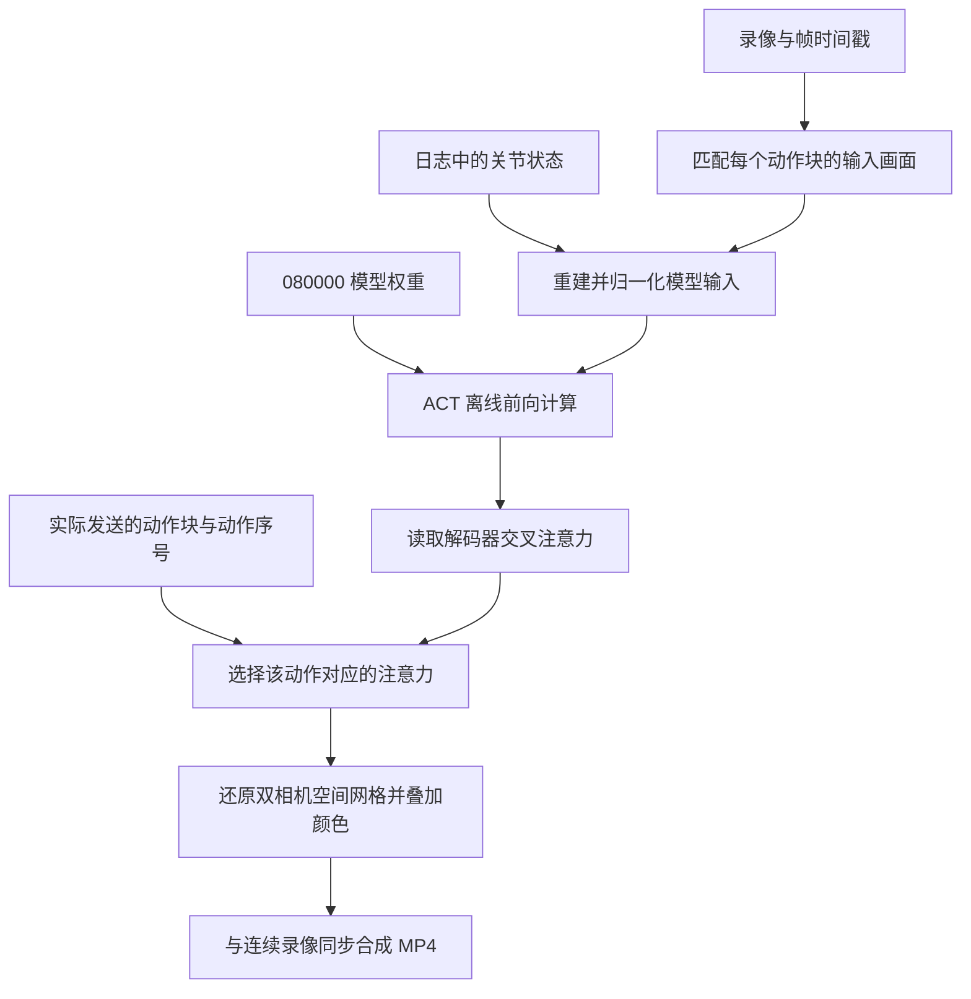

# ACT 推理注意力热力视频生成原理报告

日期：2026-10-17  
实验：`20261017-095317-752014 / round-001`  
模型：`act_stack_20261015_run01 / checkpoint 080000`  
对应成果：`20261017-095317-752014-round-001-enhanced`

## 1. 工作概述

本次使用实机推理时记录的双相机录像、关节状态、动作块和时间戳，加载同一份 ACT 模型及其归一化参数，**离线重算推理过程中的交叉注意力，再将注意力映射回对应的相机输入画面**。

原日志没有保存运行时的 attention 张量，因此本次成果属于离线重建。录像中的压缩损失、缺失输入帧以及可能的数值计算差异，使重建结果与原实机推理存在误差。模型原始 attention 未保存，无法直接测量两者的 attention 差异。

| 项目 | 本次结果 |
| --- | --- |
| 处理范围 | 最新十轮实验中的第 1 轮 |
| 相机 | top（俯视）、wrist（腕部），每路 640×480 |
| 重建的原始模型调用 | 11 次，每次预测 100 个动作 |
| 日志中的实际发送动作 | 1,074 个 |
| 视频 | 36.3667 秒，30 fps，1,091 帧 |
| 输出分辨率与编码 | 1280×1192，H.264，yuv420p |
| 注意力数据 | `float32`，形状 `11×100×602` |
| 离线生成耗时 | 本次记录约 35.59 秒 |

[观看热力视频](../outputs/act-attention/20261017-095317-752014-round-001-enhanced/attention.mp4) · [查看重建报告](../outputs/act-attention/20261017-095317-752014-round-001-enhanced/report.json) · [查看验证记录](../outputs/act-attention/20261017-095317-752014-round-001-enhanced/validation.json)


## 2. 输入数据与处理流程

原始实验记录位于 `outputs/act-traces/20261017-095317-752014/round-001/`，各文件承担不同作用。

| 文件 | 用途 |
| --- | --- |
| `trace.json` | 确认模型路径、关节顺序、动作块长度和控制频率 |
| `steps.jsonl` | 提供每步关节反馈、相机输入时间戳、实际执行的 `chunk_id`、`chunk_step` 和发送时间 |
| `chunks.jsonl` | 提供每次模型调用对应的观测索引、起止时间和原始预测动作 |
| `top.mkv`、`wrist.mkv` | 提供可解码的相机画面 |
| `top-frames.jsonl`、`wrist-frames.jsonl` | 将录像帧编号、视频时间和相机采集时间对应起来 |
| 上一级 `session.json` | 核对精度、插值等实际推理配置 |
| 模型目录中的权重及预处理器 | 恢复训练好的 ACT 和当时使用的归一化参数 |



实现入口是 [visualize_act_attention.py](../scripts/visualize_act_attention.py)，环境入口是 [visualize_act_attention.sh](../scripts/visualize_act_attention.sh)。整个生成过程使用文件中的数据进行计算，不接入硬件。

## 3. 从 ACT 中读取哪一种 attention

### 3.1 恢复原模型输入

每次重建只使用对应动作块生成时的输入：两路相机 RGB 图像，以及以下顺序的六维关节状态。

```text
shoulder_pan.pos → shoulder_lift.pos → elbow_flex.pos
→ wrist_flex.pos → wrist_roll.pos → gripper.pos
```

脚本核对训练数据中的状态顺序与日志顺序，使用项目原有的 `prepare_observation_for_inference` 和保存的 `policy_preprocessor`：图像由 uint8 转为浮点数并除以 255，转换为通道在前的格式，再应用模型保存的均值、标准差等预处理参数。

模型处于 `eval()` 和 `torch.inference_mode()`，本次不启用混合精度。按照该 ACT 实现的推理路径，VAE 潜变量取零，模型一次输出 `100×6` 个归一化动作值。

### 3.2 读取解码器对图像特征的交叉注意力

提取位置为：

```text
model.decoder.layers.0.multihead_attn
```

本模型有 4 层 Transformer encoder、1 层 decoder，注意力头数为 8。选择上述模块，是因为这里计算的是**动作 query 对 encoder 输出 token 的注意力分配**。

对第 h 个注意力头，其权重可以写为：

```text
A_h = softmax(Q_h × K_hᵀ / √d_head)
A   = (A_1 + A_2 + ... + A_8) / 8
```

其中 `Q_h` 是投影后的动作查询，`K_h` 是投影后的 encoder 特征键；模型中的位置编码已参与这些输入的形成。`d_model=512`，因此本模型的 `d_head=512/8=64`。

当前代码调用 PyTorch `MultiheadAttention` 时保留了默认的权重返回行为，得到跨头平均后的权重。脚本通过只读 forward hook 取得该返回值，不改动注意力计算参数或模块输出。关于跨头平均与返回维度，见 [PyTorch 2.11 MultiheadAttention 文档](https://docs.pytorch.org/docs/2.11/generated/torch.nn.MultiheadAttention.html)。本次实际运行版本为 `torch 2.11.0+cu128`。

单次前向取得的张量形状为：

```text
[batch, action_queries, source_tokens] = [1, 100, 602]
```

每个 query 对应未来一个时刻的**完整六维动作向量**。本次热力图没有进一步区分肩、肘或夹爪等单个动作维度，也没有分别导出八个注意力头。

## 4. 将 602 个权重还原为双相机热力图

本模型使用 ResNet-18 提取图像特征。640×480 输入经过 backbone 后，得到高 15、宽 20 的空间网格，每路相机包含 300 个空间 token。

根据本地 [ACT 模型实现](../lerobot/src/lerobot/policies/act/modeling_act.py)，encoder 输入 token 的顺序如下，索引从 0 开始。

| token 索引 | 内容 | 数量 |
| --- | --- | ---: |
| 0 | 推理时取零的 VAE 潜变量，经投影后的 token | 1 |
| 1 | 六维关节状态投影得到的 token | 1 |
| 2–301 | top 相机的空间特征 | 300 |
| 302–601 | wrist 相机的空间特征 | 300 |

对动作序号 `q`，空间映射为：

```python
top_map = attention[q, 2:302].reshape(15, 20)
wrist_map = attention[q, 302:602].reshape(15, 20)
```

这里采用与模型 `(h w)` 展平相反的行优先还原顺序。相机顺序来自模型的 `image_features`，网格大小来自 backbone hook 的实际输出，并经过维度检查。

完整 602 个权重之和约为 1。用于画图时取出两个图像区域，**保留原始权重，不对各相机重新归一化**。画面中的 `WEIGHT MASS` 显示两路相机、latent 和 state 各自的权重总和。

随后使用双线性插值，将 15×20 网格放大到 640×480。画面的平滑过渡来自插值；有效空间分辨率仍由原始特征网格决定。卷积特征的感受野有重叠，不能把每个格子理解为一个独立、精确的 32×32 像素判断区域。

## 5. 动作、输入帧与视频时间如何对齐

### 5.1 按原来的动作块节奏重建

本轮设置为 `chunk_size=100`、`n_action_steps=100`，未启用 temporal ensembling，插值倍率为 1。

ACT 一次读取观测，预测 100 个动作，再依次从动作队列中取出动作。按 30 Hz 估算，一块可执行约 3.33 秒；实际对齐使用日志时间戳。

本轮共生成 11 块，即 1,100 个预测动作，其中前 10 块全部执行，最后一块执行前 74 个动作，总计 1,074 个。剩余 26 个预测保存在数组中，但不进入已执行动作统计和色阶上限的计算。

因此，视频下排在同一动作块内保留同一组输入画面，并随着 `chunk_step` 变化选择不同 query 的热力图。无需对每个视频帧重新运行一次模型。

### 5.2 匹配模型输入帧

脚本通过 `chunks.jsonl` 中的 `observation_index` 找到当时的观测，再读取 `steps.jsonl` 中的相机 `capture_t_s`，与对应相机的帧日志匹配。

| 动作块 | top 输入匹配误差 | wrist 输入匹配误差 |
| --- | ---: | ---: |
| 第 1 块 | +29.876 ms | +40.722 ms |
| 第 2–11 块 | 0 ms | 0 ms |

正号表示选用的录像帧晚于原模型输入帧。第 1 块的原输入帧未完整保存在录像中，因此选取最近帧并在视频中标注 `nearest`；其余十块两路相机都匹配到了原采集时间戳。匹配误差超过 100 ms 时，当前脚本会终止，而不会继续用远离输入时刻的画面重建。

时间戳相同只表明匹配到同一采集时刻的录像帧，不能消除 H.264 编码造成的像素变化。相机时间戳表示主机获得画面的时间，也不等于相机硬件曝光时间。

### 5.3 对齐视频中的当前动作

输出视频第 `k` 帧对应 `t=k/30` 秒：

1. 上排各相机选择 `capture_t_s ≤ t` 的最新录像帧。
2. 动作选择 `packet_finished_t_s ≤ t` 的最近一次成功发送记录。
3. 从该记录取出 `chunk_id` 和 `chunk_step`，选择下排使用的输入帧与注意力。

这样，在新动作块仍在计算时，视频继续对应上一条已发送动作。第一次动作发送完成前，下排显示等待状态。

`packet_finished_t_s` 表示主机完成目标位置数据包发送的时间，不是各舵机已到达目标位置的时间。画面中的 `INPUT AGE` 使用两个相机原输入时间中较早的一个计算，表示这组视觉输入中较旧画面的年龄。

本轮 1,091 个输出视频帧中，共显示到 1,054 个不同的已发送动作。固定 30 fps 重采样使 20 个持续时间较短的动作区间没有单独的视频帧；完整动作日志与重建数组仍保留，可用于逐动作检查。

## 6. 热力颜色与视频布局

### 6.1 全片统一的颜色变换

色阶上限由全部 1,074 个已执行动作、两路相机的原始空间权重共同计算：

```text
vmax = 99.5% 分位数 = 0.013663139194250107
p    = 双线性放大后的空间权重
u    = clip(p / vmax, 0, 1) ** 0.5
```

所有帧和两路相机共用同一个 `vmax` 与 `gamma=0.5`。平方根变换提高低权重区域的可读性；超过上限的权重在显示时饱和。原始权重仍完整保存在 NPZ 文件中。

颜色由 TURBO 色图生成，透明度随显示值变化：

```text
alpha   = 0.45 + 0.2 × u
overlay = (1 - alpha) × RGB输入图像 + alpha × TURBO(u)
```

该设计保持跨帧、跨相机的色阶一致性。暖色表示当前统一色阶下更大的权重；由于使用非线性映射和上限截断，颜色差异不能直接当作权重比例。

### 6.2 四格画面的含义

| 位置 | 显示内容 |
| --- | --- |
| 左上 | 当前 top 推理录像 |
| 右上 | 当前 wrist 推理录像 |
| 左下 | 当前执行动作所属动作块的 top 输入帧与热力图 |
| 右下 | 当前执行动作所属动作块的 wrist 输入帧与热力图 |

下排保留原输入画面，是因为机械臂移动后，相机内容和物体位置可能已经变化。把旧输入的 attention 原坐标直接覆盖到后来的录像帧，会造成空间错位；当前实现没有做光流、跟踪或运动补偿。

## 7. 验证结果与精度边界

| 检查 | 结果 | 能说明什么 |
| --- | --- | --- |
| 五项测试 | 全部通过 | 覆盖网格方向、相机顺序、缺帧提示、动作时间边界和真实 ACT hook 检查 |
| 真实 checkpoint 首次重建输入，hook 开关前后的预测最大差 | 0 | 本次检查中读取 attention 未改变模型输出 |
| 602 个概率之和的最大误差 | 约 `1.19×10⁻⁷` | 取得的权重满足数值精度内的概率和检查 |
| 已执行动作重建 MAE | `0.0248197` | 重算动作与原日志的归一化平均绝对差 |
| 已执行动作最大绝对误差 | `0.9206486` | 个别动作分量的偏差明显大于平均值 |
| 输出视频完整解码 | 1,091 / 1,091 帧 | 未发现视频截断或解码失败 |
| 输出时间线检查 | 1,091 帧全部通过 | 每帧均选择对应时刻最近已发送的动作 |
| 来源 SHA-256 校验 | 16 项通过 | 验证时相关源文件与生成报告中记录的内容一致 |
| 两种显示版本的数组比较 | 完全相同 | 色阶调整只影响展示，不改变 attention 和动作数组 |

动作误差以**模型归一化后的单位**计算，不能直接解释为角度、归一化夹爪百分点或百分比。MAE 聚合范围为实际发送的 1,074 个动作、每个动作的 6 个分量。

逐关节 MAE 如下：

| 关节 | 归一化 MAE |
| --- | ---: |
| shoulder_pan | 0.0188863 |
| shoulder_lift | 0.0193816 |
| elbow_flex | 0.0203734 |
| wrist_flex | 0.0262155 |
| wrist_roll | 0.0269349 |
| gripper | 0.0371267 |

最大误差出现在约 `29.3679 s` 发送的动作：第 9 块、第 67 个动作（`chunk_step=66`），夹爪分量的归一化绝对误差为 `0.9206486`。平均误差不能代表每个时刻都接近原动作。

这些动作对比用于检查离线重建的一致程度，**无法据此给出 attention 本身的误差上界**。视频压缩和第 1 块缺帧是已知限制；当前验证未单独量化各项因素对动作偏差的贡献。

还需结合模型结构理解热力图：cross-attention 的对象已经经过 encoder 的上下文融合，它表示对这些空间 token 的分配，不等于原始像素的独立贡献，也不是物体分割或动作正确性的因果证据。画面中 latent/state 的直接权重很小，也不表示关节状态没有通过 encoder 影响其他 token。

## 8. 交付文件与复用方法

最终输出位于 `outputs/act-attention/20261017-095317-752014-round-001-enhanced/`。

| 文件 | 内容 |
| --- | --- |
| [attention.mp4](../outputs/act-attention/20261017-095317-752014-round-001-enhanced/attention.mp4) | 最终热力视频 |
| [contact-sheet.jpg](../outputs/act-attention/20261017-095317-752014-round-001-enhanced/contact-sheet.jpg) | 四个时刻的画面预览 |
| [attention.npz](../outputs/act-attention/20261017-095317-752014-round-001-enhanced/attention.npz) | 注意力、重建动作、原记录动作及维度信息 |
| [report.json](../outputs/act-attention/20261017-095317-752014-round-001-enhanced/report.json) | 方法、参数、逐块帧匹配、误差及来源指纹 |
| [validation.json](../outputs/act-attention/20261017-095317-752014-round-001-enhanced/validation.json) | 时间线、完整解码和数组一致性检查 |
| [video-timeline.jsonl](../outputs/act-attention/20261017-095317-752014-round-001-enhanced/video-timeline.jsonl) | 每个输出帧对应的相机帧、动作记录和 query |

`attention.npz` 中的主要数组为：

```text
attention               float32 [11, 100, 602]
actions_reconstructed   float32 [11, 100, 6]
actions_recorded        float32 [11, 100, 6]
chunk_ids               int64   [11]
feature_grids_hw        int64   [2, 2]
prefix_tokens          int64   scalar，值为 2
```

在工作区根目录运行以下命令，可用同样方法生成另一份输出：

```bash
bash scripts/visualize_act_attention.sh \
  --trace-dir outputs/act-traces/20261017-095317-752014/round-001 \
  --output-dir outputs/act-attention/round-001-report-repro \
  --device cuda \
  --fps 30 \
  --color-gamma 0.5
```

输出目录必须不存在。脚本使用现有 `lerobot-so101` 环境，模型及缓存均使用工作区路径。当前导出器适用于这里的双相机 640×480 输入、全精度推理、无 temporal ensembling、无动作插值的记录。

如果后续需要保留实机当时的精确 attention，采集方案应在原始前向过程中直接记录 attention，或保存可精确重放的模型输入张量及运行配置。该方案还需评估记录开销对控制时序的影响；本次工作只使用既有实验数据完成离线重建。
