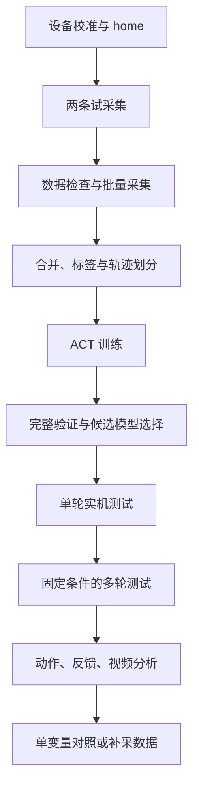

# SO-101／ACT 工作流复用指南

整理日期：2026-10-17。适用范围：SO-101 主从臂、双路 RGB、LeRobot v3 数据集、ACT 单任务训练，以及从臂实机测试。

这份文档整理了当前项目可复用的代码、可执行入口、迁移时要改的地方，以及交给 AI 的实施提示词。新任务可以沿用控制和记录结构，再替换设备、数据、任务和模型配置。

当前代码基线是 `Seeed-Projects/lerobot`，提交 `4aaff99be4a1d81568c08c8f0296b41b40c99ec4`。下文中的“LeRobot 接口”均指这个工作区实际使用的版本。迁移到其他版本时，需要重新核对配置解析、数据处理器和 rollout 接口。

## 1. 快速使用顺序

已有本工作区和硬件时，先看第 3 节的采集入口和第 7 节的推理入口。从空目录编写脚本，请使用 [从零搭建提示词](SO101_ACT从零搭建提示词.md)，其中 P4 重点定义采集按键，P6 重点定义终端 Enter 推理与实时相机观察。已有代码的迁移可继续使用本文第 11 节 P0–P7。

| 阶段 | 入口或核心模块 | 完成标志 |
| --- | --- | --- |
| 环境与设备绑定 | `activate.sh`、`check_env.py`、校准和 home 配置 | 导入路径、设备身份、单位和图像名称明确 |
| 两条试采集 | `collect_so101.sh` | 保存两条演示，视频可解码，动作和状态对应 |
| 批量采集与审核 | `audit_act_dataset.py` | 帧数、轨迹边界、图像和动作质量通过检查 |
| 合并与划分 | `prepare_act_dataset.py`、`make_train_eval_datasets()` | 保存来源映射、训练／验证轨迹清单 |
| ACT 训练 | `lerobot_train` | 新训练目录中保存配置、处理器、模型和日志 |
| 完整验证 | `evaluate_act_full.py` | 所有候选检查点覆盖同一个完整验证集 |
| 单轮与多轮实机测试 | `act_trial_loop.py` | 实际参数、轮次、动作和双路视频归档 |
| 失败分析与对照 | `analyze_execution_trace.py` | 视频与实际执行动作对齐，按单一变量比较 |



当前工作区的重要命令审核规则见 [AGENTS.md](../AGENTS.md)。AI 可以先完成代码、配置和离线检查；实机操作、长时间训练／评估、依赖升级等，在执行前提交完整命令与实际生效参数。已批准的具体命令和范围不重复审核，关键参数变化时说明差异。本文中的运行命令是操作说明，本次文档整理没有启动硬件、训练或全量评估。

## 2. 哪些代码可以直接复用

### 2.1 脚本职责和复用边界

| 文件 | 主要职责 | 复用时需要处理的内容 |
| --- | --- | --- |
| [so101_collect.py](../scripts/so101_collect.py) | `record/status/archive` 终端入口 | 固定读取 `so101_collect.json`，固定主臂 PID 核对值 16/0/32 |
| [so101_adaptive.py](../scripts/so101_adaptive.py) | 设备连接、采集循环、异步写入、预览调度 | 可传配置；当前限定 SO-101、top/wrist、640×480、30 Hz |
| [so101_session.py](../scripts/so101_session.py) | 腕转映射、home、采集状态机、双臂复位 | 固定六关节及角度／夹爪百分点表示；home 与校准哈希绑定 |
| [so101_passive_calibrate.py](../scripts/so101_passive_calibrate.py) | 单臂被动校准 | 新设备需重新核对 ID、方向和范围，保存独立校准文件 |
| [audit_act_dataset.py](../scripts/audit_act_dataset.py) | 结构检查、完整视频解码、抽帧 | 支持传入多个数据目录；仍写死六维动作、task_index=0、640×480 |
| [prepare_act_dataset.py](../scripts/prepare_act_dataset.py) | 根据审核结果合并数据并检查内容一致 | 写死审核路径、输出目录、50 条和 53,475 帧，需要参数化 |
| [check_act_training.py](../scripts/check_act_training.py) | 检查配置、划分、样本尺寸和有限值 | 写死训练配置、45/5 划分、100×6 动作及报告路径 |
| [train_act_stack.sh](../scripts/train_act_stack.sh) | 环境变量、预训练权重校验、启动训练 | 配置、日志和训练目录固定；不转发额外参数，旧目录存在即拒绝运行 |
| [evaluate_act_full.py](../scripts/evaluate_act_full.py) | 所有检查点的完整离线验证 | 已有 `--config`；仍限定本次 20 个步数、45–49、CUDA FP16、原训练日志等 |
| [act_trial_loop.py](../scripts/act_trial_loop.py) | 加载官方 rollout，连接、复位、执行、清理 | 通过配置适配设备和模型；追踪模式限定 ACT、sync、无时序集成 |
| [act_trial_session.py](../scripts/act_trial_session.py) | 回车状态机、轮次和计时 | 不依赖真实硬件，可单独测试或接其他 backend |
| [act_execution_trace.py](../scripts/act_execution_trace.py) | 实际动作、chunk、发送目标、反馈和录像 | 依赖 ACT 内部队列、Feetech 总线及相机缓存接口 |
| [act_trial_preview.py](../scripts/act_trial_preview.py) | 相机缓存实时预览 | 需要 `ffplay` 和桌面会话；不重复打开摄像头 |
| [analyze_execution_trace.py](../scripts/analyze_execution_trace.py) | 时间线、张开候选事件、前后两秒视频 | 当前按 `gripper.pos`、top/wrist 分析；会写入 `analysis/` |
| [audit_act_checkpoints.py](../scripts/audit_act_checkpoints.py) | 旧检查点数值审核和离线推理检查 | 仍根据原 500 帧日志选模型，不应作为新实验的全量选型入口 |

### 2.2 迁移时需要一起带走的依赖

采集部分至少包含：

```text
collect_so101.sh
so101_collect.py
so101_adaptive.py
so101_session.py
so101_preview.py
so101_voltage.py
diagnose_teleop.py
```

需要重新校准或只读设备检查时，再带上 `so101_passive_calibrate.py`、对应 shell 入口和 `so101_readonly.py`。

实机验证部分至少包含：

```text
act_trial_trace.sh
act_trial_loop.py
act_trial_session.py
act_execution_trace.py
act_trial_preview.py
analyze_execution_trace.py
diagnose_teleop.py
```

此外需要 LeRobot 源码、环境依赖、配置 JSON 和对应测试。`scripts/` 下的模块通过同目录导入，移动时要保留这种关系。`activate.sh` 写死了当前工作区和 Conda 路径，迁移后必须调整。`check_env.py` 也写死了环境路径，并使用 `logs/video-smoke.mp4` 作解码检查；新环境应生成自己的测试视频或修改检查输入。

不要把原设备的校准和 home 当作新机械臂的可直接使用配置。可以复用字段结构，但实际范围、腕转偏移和初始姿态需要对应新设备。

### 2.3 配置中应集中管理的字段

| 类别 | 需要填写或核对的字段 |
| --- | --- |
| 路径 | 工作区、Python 环境、数据目录、缓存、训练输出、验证输出、实机会话输出 |
| 主从臂 | `port`、`id`、`calibration_dir`、`use_degrees`、PID、`max_relative_target` |
| 图像 | 相机名称、设备路径、RGB/BGR、宽高、fps；采集和模型输入名称保持一致 |
| home | 校准哈希、两臂 home、腕转偏移；部署只使用从臂 home |
| 数据 | 任务文本、批次名称、条数、最长时长、位置标签、训练／验证轨迹 |
| 训练 | 数据根目录、chunk_size、batch、学习率、步数、评估范围、保存频率 |
| 部署 | checkpoint 路径、n_action_steps、控制频率、时序集成、插值倍率、每轮时长 |
| 实验 | 轮数、相机预览、场景整理时间、结果判据、结果标签表 |

## 3. 数据采集：入口、状态机和数据语义

### 3.1 在当前工作区试采两条

下面使用当前机械臂、校准和任务配置。更换硬件或任务时先完成配置适配。

```bash
source /home/pangk/workspaces/so101-training/activate.sh
SO101_WORKSPACE=/home/pangk/workspaces/so101-training
SO101_PYTHON=/home/pangk/miniforge3/envs/lerobot-so101/bin/python
SO101_BATCH=so101_workflow_demo_01
cd "$SO101_WORKSPACE"

export XDG_CACHE_HOME="$SO101_WORKSPACE/.cache"
export XDG_CONFIG_HOME="$SO101_WORKSPACE/.cache/config"
export XDG_DATA_HOME="$SO101_WORKSPACE/.cache/share"
export HF_HOME="$SO101_WORKSPACE/.cache/huggingface"
export HF_DATASETS_CACHE="$SO101_WORKSPACE/.cache/huggingface/datasets"
export HF_LEROBOT_HOME="$SO101_WORKSPACE/data/datasets"
export HF_LEROBOT_CALIBRATION="$SO101_WORKSPACE/data/calibration"
export TORCH_HOME="$SO101_WORKSPACE/.cache/torch"
export UV_CACHE_DIR="$SO101_WORKSPACE/.cache/uv"
export TMPDIR="$SO101_WORKSPACE/.cache/tmp"
export PYTHONUNBUFFERED=1
export OMP_NUM_THREADS=4
export MKL_NUM_THREADS=4
mkdir -p "$TMPDIR"
```

这些环境变量只作用于当前终端及其子进程。新终端需要重新设置；迁移工作区时一并调整路径。

先打印实际配置。此模式不打开机械臂或相机，不创建数据集；shell 包装器仍会追加自己的运行日志。

```bash
bash scripts/collect_so101.sh record \
  --name "$SO101_BATCH" --episodes 2 --check
```

核对配置并完成本次命令审核后，运行相同命令，去掉 `--check`：

```bash
bash scripts/collect_so101.sh record \
  --name "$SO101_BATCH" --episodes 2
```

`so101_collect.py` 内部使用 `--feedback-mode official --expected-leader-pid 16 0 32`。如果要使用另一个采集配置，使用支持 `--config` 的入口，而不是向 `collect_so101.sh` 添加不存在的参数：

```bash
# 模板：先准备好这个新配置文件，再做离线检查。
bash scripts/so101_session.sh \
  --config configs/collect_new_task.json \
  --mode record --feedback-mode official \
  --expected-leader-pid 16 0 32 \
  --dataset-name so101_new_task_01 --episodes 2 --check
```

上面的 PID 是当前设备的核对值，不是为新设备自动选取的设置。该入口的默认主臂核对值为 32/0/32，因此应显式传入实际确认的值。正式采集使用同一组已审核参数去掉 `--check`。

| 按键 | 作用 |
| --- | --- |
| S | 在准备状态开始跟随并录制 |
| N | 保存成功演示，保存完成后复位 |
| R | 作废未保存片段并复位；故障恢复后需要重新按 R |
| V | 第一条保存后，确认人工复查完成 |
| M | 在对应暂停状态恢复手动跟随 |
| Q / Esc | 退出并执行清理 |

达到 120 秒只停止录帧并等待 N/R，不自动判断成功。采集按键在双相机控制窗口生效。完整操作说明见 [采集手册](collect-manual.md)。

### 3.2 每一帧如何产生

调用关系为 `Hardware.observe()` → `Session.step()` → `Hardware.send()` → `AsyncDatasetWriter.add()`。下面是简化逻辑，不是一个可独立运行的硬件程序：

```python
obs = hardware.observe()
target = session.manual_target(obs)       # 主臂位置转换到从臂坐标
sent = hardware.send("follower", target)
if session.state == "RECORDING":
    writer.add(obs, sent)
```

| 数据 | 含义 |
| --- | --- |
| `observation.state` | 发送本次目标之前读取的从臂实测位置，6 维 |
| `action` | 本次发送给从臂的位置目标，6 维 |
| `observation.images.top/wrist` | 同一控制周期取得的双路图像 |
| 索引 | episode_index、frame_index、全局 index、timestamp、task_index |

六维顺序为 `shoulder_pan, shoulder_lift, elbow_flex, wrist_flex, wrist_roll, gripper`。前五维是角度，夹爪是 0–100 百分点，越小越闭合。夹住物体后，目标与反馈可以不同；数据中保存了这种差异。这里没有独立的力／扭矩标签，不能把位置差直接当成夹持力。

`AsyncDatasetWriter` 使用一个后台线程串行执行帧写入、保存、作废和 finalize。队列容量为 30，图像入队时复制；编码不会直接阻塞控制循环。队列满或写入失败会报错，不静默丢弃训练帧。保存通过 Future 返回，`finish_pending_write()` 负责只结算一次，防止复位异常后重复计数。

原始状态／动作保存在 Parquet，双路图像保存为 H.264，元数据采用 LeRobot v3 格式。当前视频配置为 640×480、30 fps、CRF 23、GOP 2、ultrafast。

### 3.3 采集控制与复位的区别

手动跟随和录制使用 `MotorsBus.sync_read("Present_Position")`。启动、自动保持及双臂复位使用完整反馈。采集入口只核对 PID／模式，不通过原生 `connect()` 重写整套电机设置。

采集复位由 `DirectResetPlan` 完成：两臂分别从实测位置返回各自 home，采用五次插值，先倒计时 2 秒，运动最短 2 秒；根据目标位移和配置的目标速度、加速度约束延长时间。自动回程、等待和场景整理不进入训练数据。

现有边界容差为 16 个编码器计数；`max_relative_target=null`。这些是本次已使用的控制设置，迁移时应显式核对，不在普通代码整理中改变。

## 4. 数据检查、位置标签和合并

采集程序退出后检查提交状态：

```bash
bash scripts/collect_so101.sh status "$SO101_BATCH"
```

`status` 核对元数据和 Parquet 行数，不完整解码视频，也不判定任务成功。随后进行完整结构检查；下面会新建审核目录，目录已存在时应使用另一个名称。

```bash
"$SO101_PYTHON" scripts/audit_act_dataset.py \
  --output "outputs/workflow-audit/$SO101_BATCH" \
  "data/datasets/$SO101_BATCH"
```

审核脚本接受多个源数据目录。检查内容包括六维动作／状态的有限值、帧索引连续性、episode 边界、时间戳、视频完整解码、分辨率和视频时间间隔；生成首／中／末帧拼图和 `integrity-report.json`。结构通过后仍需检查动作质量。

为了按摆放位置分析，新实验建议增加旁路标签表，避免修改原始数据。以下是建议的 `episode_labels.csv` 格式，现有采集器不会自动生成它：

```csv
dataset_name,episode_index,position_id,lighting_id,success,notes
so101_new_task_01,0,P1,L1,1,
so101_new_task_01,1,P3,L1,1,
```

`dataset_name + episode_index` 标识源演示。合并后保留源编号到合并编号的映射，再保存明确的训练／验证轨迹清单。按完整轨迹划分，避免同一演示的相邻帧跨集合。位置标签不足时如实保留缺失值，不依据轨迹顺序猜位置。

`prepare_act_dataset.py` 已实现调用 `aggregate_datasets()`、检查动作和时间戳不变、核对视频哈希、写 `preparation-manifest.json`。它目前限定本次实验，迁移需要把审核报告、输出目录及预期数量改为输入参数，并从审核结果读取数量。脚本采用 `concatenate_videos=False`、`concatenate_data=False`，检查复制后的视频内容相同。

当前 `make_train_eval_datasets()` 按任务取末尾轨迹留出验证。本次 `eval_split=0.1` 得到 0–44 训练、45–49 验证；代码没有按五个摆放位置分层。新任务若需要位置分层，要真正把划分清单接入加载器，再核对加载结果，不能只在文档里写“分层划分”。

## 5. 训练配置和可复用的预检

以 [本次训练配置](../configs/train_act_stack_20261015.proposed.json) 为结构模板，新实验至少修改数据根目录、repo_id、输出目录和 job_name。模型基础配置为 ACT、ResNet18、chunk_size=100、batch_size=4、AdamW、lr=1e-5、100,000 步，每 5,000 步保存。

新 workflow 建议显式设置 `max_eval_samples=0`。如果训练期间为了节约评估时间设置采样上限，应标注采样范围，并在最终选择模型前补做全量评估。

训练样本应检查：状态 `[6]`、双路图像各 `[3,480,640]`、动作 `[100,6]`、末尾补齐掩码 `action_is_pad`，并确认所有数值有限。`check_act_training.py` 可以复用检查逻辑，但它的配置路径、输出位置和 45/5 断言需要先适配。

状态与动作采用均值、标准差归一化，图像使用 ImageNet 统计量。对新训练，应只由训练轨迹计算状态／动作统计量，并验证实际加载的处理器使用了它们。当前旧实验的统计量来自全部 50 条；复评旧模型时沿用已保存的统计量，不能直接换一套统计量后继续比较原模型。

`train_act_stack.sh` 会检查 ResNet18 本地缓存、设置离线模式和缓存路径，再启动训练。它写死了旧实验配置及输出路径，而且没有转发 `"$@"`；向它追加 `--config_path` 不会切换训练配置。旧训练目录已存在，原脚本会拒绝重复运行。

下面是新配置生成后的启动模板，需要先完成训练参数审核，并使用第 3.1 节的工作区缓存设置。确认所需权重已下载并核对哈希后启用离线模式；新机器下载准备阶段不使用这两个离线开关。

```bash
# 模板：configs/train_act_new_task.json 须先由配置适配步骤生成并检查。
export HF_HUB_OFFLINE=1
export HF_DATASETS_OFFLINE=1
uv run --no-project --python "$SO101_PYTHON" python \
  -m lerobot.scripts.lerobot_train \
  --config_path="$SO101_WORKSPACE/configs/train_act_new_task.json"
```

检查点应完整保留 `model.safetensors`、`config.json`、`train_config.json`、前后处理器 JSON 及统计量 safetensors。部署时传 `pretrained_model` 目录，不只复制一个权重文件。

## 6. 完整离线验证和模型选择

入口为 [evaluate_act_full.py](../scripts/evaluate_act_full.py)，配置结构参考 [全量评估配置](../configs/eval_act_stack_full_20261017.proposed.json)。

核心流程：读取保存的训练配置 → 构造同一验证集 → 加载每个检查点及其处理器 → `policy.eval()` → `torch.inference_mode()` → 遍历全部 batch → 汇总并排序。当前实现使用 CUDA FP16，与原训练评估精度一致。

```python
# 算法示意。实际脚本还核对帧索引、轨迹计数及模型处理器哈希。
loader = DataLoader(validation, batch_size=4, shuffle=False, drop_last=False)
for checkpoint in checkpoints:
    policy, preprocessor = load_saved_model_and_processors(checkpoint)
    for raw in loader:
        batch = preprocess(raw, preprocessor)
        loss, details = policy(batch)
        accumulate(loss, raw["episode_index"])
```

评估模式下的 ACT 不计算训练 VAE 的 KL 项。单个 batch 的 L1 损失是有效动作元素的平均绝对误差。当前主要排名指标为各 batch 损失的算术平均，另行输出全局有效元素加权结果、逐轨迹结果和等轨迹权重结果。两种主要统计都屏蔽 padding，差异在跨 batch 的权重。

| 输出 | 用途 |
| --- | --- |
| `evaluation-plan.json` | 配置、数据范围、源码与处理器哈希、环境信息 |
| `checkpoint-XXXXXX.json` | 单个检查点损失、逐轨迹结果、耗时、显存和权重哈希 |
| `ranking.csv` | 所有检查点排名及各轨迹损失 |
| `checkpoint-selection.json` | 最低损失候选及完整排名；不自动改变实机配置 |

当前脚本仍要求 005000–100000 共 20 个检查点、验证 episode 45–49、原训练 eval_split=0.1、匹配的训练日志等。新数据或不同训练步数必须先参数化这些要求。保留“和本次计划一致”的检查，但把期望值来自配置或清单，不能简单删除检查后默认验证完整。

下面的命令适用于配置和脚本已经适配完成的情况：

```bash
# 模板：评估输出必须是新目录。
"$SO101_PYTHON" scripts/evaluate_act_full.py \
  --config configs/eval_act_new_task.json --check-only
```

审核本次资源占用、检查点范围、验证集和输出位置后，去掉 `--check-only` 执行。原 `evaluate_act_full.sh` 固定指向已完成的评估配置，原输出目录已存在；包括原配置的 `--check-only` 在内都会被“输出已存在”检查阻止，不能把这个错误当成模型或数据故障。

本次已完成的全量结果为：20 个检查点，每个覆盖五条轨迹、5,489 帧；025000 最低，损失 0.288546；080000 为 0.305988，排名第 4。完整结果见 [ranking.csv](../outputs/act-full-validation-20261017/ranking.csv)。

## 7. 实机推理：回车循环、相机预览和十轮测试

### 7.1 当前配置和入口

当前入口是 [act_trial_trace.sh](../scripts/act_trial_trace.sh)，读取 [act_trial_trace_080000_100.proposed.json](../configs/act_trial_trace_080000_100.proposed.json)，调用 `act_trial_loop.py`。

先做离线检查：

```bash
bash scripts/act_trial_trace.sh \
  --max_rounds=10 --camera_preview=true --preview_fps=15 \
  --check=true
```

核对输出并审核本次命令后启动：

```bash
bash scripts/act_trial_trace.sh \
  --max_rounds=10 --camera_preview=true --preview_fps=15
```

本条命令仍使用 080000。JSON 本身没有设置十轮上限和实时预览；这里由命令行显式启用。没有传这些参数时，`max_rounds` 默认为无限轮，`camera_preview` 默认为关闭。

| 项目 | 当前生效值 |
| --- | --- |
| 从臂端口／ID | `/dev/serial/by-id/usb-1a86_USB_Single_Serial_5AB9065574-if00`；`my_awesome_follower_arm` |
| 从臂校准 | `data/calibration/recalibration-20261014-152423-manual/follower/my_awesome_follower_arm.json` |
| 采集主臂端口／ID | `/dev/serial/by-id/usb-1a86_USB_Single_Serial_5AAF220248-if00`；`my_awesome_leader_arm`；推理不连接主臂 |
| 主臂校准 | `data/calibration/replacement-leader-20261014-185158/leader/my_awesome_leader_arm.json` |
| 模型 | `outputs/train/act_stack_20261015_run01/checkpoints/080000/pretrained_model` |
| 策略／引擎 | `base`／`sync`；设备 CUDA，部署 FP32，`use_amp=false` |
| 动作 | chunk_size=100，n_action_steps=100；无时序集成，插值倍率 1 |
| 控制 | 30 Hz，单轮最长 120 秒；臂关节为度，夹爪为 0–100 |
| 目标限幅 | `max_relative_target=null`；没有额外夹爪限差 |
| home | `data/motion_profiles/stack_white_on_red_home_v1.json`，校准哈希须匹配 |
| 从臂 home 六维值 | −4.7033、−91.2967、89.7582、70.5495、−83.8242、4.7773；顺序同第 3 节 |
| 复位 | 官方线性插值，六关节同时回位，3 秒、50 Hz；不是采集时的双臂复位规划 |
| 等待 | 前九轮复位后等待 10 秒；最后一轮复位后退出 |
| top 相机 | `/dev/v4l/by-path/pci-0000:00:14.0-usb-0:14.3:1.4-video-index0` |
| wrist 相机 | `/dev/v4l/by-id/usb-Sonix_Technology_Co.__Ltd._UGREEN_Camera_2K_SN0001-video-index0` |
| 图像／预览 | RGB、MJPG、640×480、30 fps；相机预热 3 秒；显示 15 Hz |
| 舵机初始化 | 位置模式 0，PID 16/0/32，Return_Delay_Time=0，Maximum_Acceleration=254、Acceleration=254 |
| 夹爪初始化 | Max_Torque_Limit=500、Protection_Current=250、Overload_Torque=25，均为寄存器原始值 |
| 其他启动写入 | 官方连接流程处理 Torque_Enable、Lock，必要时清除 Phase 的 0x10 位；不改 Goal_Velocity |
| 启动目标 | 先关闭扭矩、读取当前位置并写入 Goal_Position，再执行官方配置与使能 |
| 通信重试 | 启动配置写入最多增加两次相同值重试；推理目标发送没有因此增加重试 |
| 数据行为 | 新建时间戳输出目录；保存实验追踪和视频，不创建训练数据集，不上传 |

这些值用于复现当前实验。新机械臂应以实际配置和 `--check=true` 的展开结果为准；软件版本变化时还要核对官方 `configure()` 的隐含写入。

### 7.2 外层状态机与官方推理如何配合

`TrialControls` 保存停止与退出事件；`EnterReader` 读取终端；`TrialLoop` 是调用 backend 运动方法的唯一位置。`OfficialBackend` 负责 `build_rollout_context()`、`BaseStrategy`、复位及清理。

```text
WAIT_HOME
  Enter → 加载模型、连接从臂和相机 → RESETTING
READY
  Enter → reset_control_state() → RUNNING
RUNNING
  Enter 或 120 秒到时 → 暂停推理 → RESETTING
COOLDOWN
  等待 10 秒 → READY
最后一轮
  RESETTING → 退出并卸扭
```

连接、复位和场景等待期间的回车不会排队执行。每轮开始清空 ACT 动作队列、处理器状态和插值器，避免上一轮动作残留。`q + Enter` 或 Ctrl+C 退出并清理，不再追加回位动作；异常退出也会尝试释放已连接部分的资源。

官方执行路径是 `BaseStrategy.run()` → `SyncInferenceEngine.get_action()` → `ACTPolicy.select_action()` → 反归一化 → 机器人处理器 → `send_action()`。

```python
# select_action 的队列语义示意。
if not action_queue:
    chunk = predict_action_chunk(current_observation)
    action_queue.extend(chunk[:n_action_steps])
action = action_queue.popleft()
```

`chunk_size` 决定模型输出长度，`n_action_steps` 决定本次输出执行多少步后重新预测。当前 100 步在 30 Hz 下约覆盖 3.33 秒；队列中途仍读取观测，但不重新预测动作。同步引擎生成新 chunk 时占用控制线程，因此缩短执行步数时应同时观察发送间隔和推理耗时。

### 7.3 两种单变量对照的离线检查命令

只改执行步数，保持 080000、chunk_size=100 和 30 Hz：

```bash
bash scripts/act_trial_trace.sh \
  --policy.path="$SO101_WORKSPACE/outputs/train/act_stack_20261015_run01/checkpoints/080000/pretrained_model" \
  --policy.n_action_steps=10 \
  --max_rounds=10 --camera_preview=true --preview_fps=15 \
  --check=true
```

当前解析器在只有 `--policy.n_action_steps=10`、模型路径仅写在 JSON 时会报缺少 `policy.type` 的错误。这里同时显式传 `--policy.path`，已通过离线解析，展开结果为 chunk_size=100、n_action_steps=10。不要额外修改训练好的 chunk_size。

只改 checkpoint，保持执行步数 100：

```bash
bash scripts/act_trial_trace.sh \
  --policy.path="$SO101_WORKSPACE/outputs/train/act_stack_20261015_run01/checkpoints/025000/pretrained_model" \
  --policy.n_action_steps=100 \
  --max_rounds=10 --camera_preview=true --preview_fps=15 \
  --check=true
```

这两项是各自独立的实验。实机执行前按本次变更重新审核完整命令，再去掉 `--check=true`。场景、相机姿态、物体位置和其他执行参数保持一致；不要在同一轮同时更换模型和执行步数。

换成新设备或新任务时，应复制 rollout JSON 到新文件并修改，再直接调用 Python 入口，避免依赖旧包装器的固定配置路径：

```bash
# 模板：先生成并检查 configs/rollout_new_task.json。
uv run --no-project --python "$SO101_PYTHON" python scripts/act_trial_loop.py \
  --config_path="$SO101_WORKSPACE/configs/rollout_new_task.json" \
  --max_rounds=10 --camera_preview=true --preview_fps=15 --check=true
```

## 8. 可复用的动作追踪、录像与失败分析

### 8.1 记录真正执行的动作

`ExecutionTrace` 用临时方法包装记录既有调用，退出时恢复原方法。它记录完整 chunk，也记录 `select_action()` 从队列中取出的动作，并检查两者对应。

```text
chunk_step = min(chunk长度, n_action_steps) − 取出后的队列长度 − 1
```

| 字段 | 能回答的问题 |
| --- | --- |
| `chunk_id`、`chunk_step`、队列长度 | 当前动作来自哪次预测、哪个时刻 |
| `selected_normalized` | 策略实际选中了什么动作 |
| `after_policy_postprocess` | 反归一化后目标是多少 |
| `after_robot_processors` | 机器人处理器是否改变了目标 |
| `raw_goal_packet`、`sent_gripper_target` | 总线发送的编码器值及换算后的夹爪目标 |
| `feedback` | 动作发送前的实际位置 |
| `inference_ms`、发送时间戳 | 新 chunk 推理是否造成明显停顿 |

当前追踪只支持 ACT＋同步推理＋无 temporal ensembling＋插值倍率 1。它依赖 ACT 的 `_action_queue` 和 Feetech 内部发送接口，升级 LeRobot 后必须复核。日志表示发送调用成功，不是逐个舵机的目标寄存器回读。

### 8.2 预览和录像共用现有相机

`CameraPreview` 从 `latest_frame/latest_timestamp` 缓存读取图像，分别交给 `ffplay` 子进程，15 Hz 显示。窗口关闭或显示失败只结束该预览，不停止策略循环。

`VideoJournal` 用独立线程将相机缓存编码成 top/wrist MKV，记录每帧时间戳；新 chunk 推理占用控制线程时仍可继续录像。视频时间是主机取得帧的时间，不是相机硬件曝光时间。缓存读取可能跳过中间帧，应检查 `video-status.json` 的帧数、间隔和错误记录。

### 8.3 会话产物

```text
outputs/act-traces/<会话时间>/
├── session.json                 # 本次展开后的实际参数
├── runtime.log                  # 执行日志和异常栈
├── rounds.csv                   # 轮号、起止时间、时长、结束原因
├── preview-top.log
├── preview-wrist.log
└── round-001/                   # 后续轮次同结构
    ├── trace.json              # 模型、动作顺序、时钟、追踪说明
    ├── chunks.jsonl            # 完整动作块
    ├── steps.jsonl             # 每个实际执行步
    ├── top.mkv
    ├── wrist.mkv
    ├── top-frames.jsonl
    ├── wrist-frames.jsonl
    ├── video-status.json
    └── analysis/               # 分析脚本运行后产生
        ├── timeline.csv
        ├── summary.json
        └── opening-*.mp4
```

对新会话某一轮分析，先把路径替换为实际目录：

```bash
# 模板：将 <本次会话目录> 换成程序打印的时间戳目录。
SO101_SESSION="$SO101_WORKSPACE/outputs/act-traces/<本次会话目录>"
"$SO101_PYTHON" scripts/analyze_execution_trace.py \
  "$SO101_SESSION/round-001" --clips
```

该命令读取原始记录，写入或覆盖本轮 `analysis/` 中的同名派生文件。需要保留旧分析版本时，先另存已有派生结果。脚本不改原始视频、动作或模型。

默认候选规则是“发送目标或反馈在 0.5 秒内增大至少 3 个夹爪百分点”，近邻事件合并，再导出事件前后各两秒。这个阈值用于离线筛选，不参与控制，也不自动判定提前松爪、成功或失败。

分析顺序为：先看选中动作是否开始张开，再看反归一化与发送目标，最后把位置反馈和视频时间对齐。视频里的正常放置松爪不能算成提前释放。反馈在同一行的动作发送前采样，要按时间先后比较。

### 8.4 手工结果表

程序没有自动给每轮判成功／失败。新实验可手动维护以下旁路表；这是建议格式，当前程序不会自动填写：

```csv
session,round,checkpoint,n_action_steps,position_id,lighting_id,result,failure_stage,notes
new_session,1,080000,100,P1,L1,success,,
new_session,2,080000,100,P1,L1,failure,lift,抬起后滑落
```

统一成功判据，例如完成叠放、松爪和撤离，并规定稳定保持时长、是否允许重抓以及如何记录人工干预。成功率按有明确结果的测试记录计算，并同时报告计划轮数、有效轮数和中止轮数。`rounds.csv` 的时长包含观察和记录开销，不直接等于任务完成时间。

## 9. 最小回归检查和阶段验收

现有测试均按各文件中的模拟设备或离线模型实现运行，不需要启动实机。修改相应模块后运行对应测试即可：

```bash
"$SO101_PYTHON" -m unittest discover -s scripts/tests -p 'test_official_collection.py' -v
"$SO101_PYTHON" -m unittest discover -s scripts/tests -p 'test_reset_fault_recovery.py' -v
"$SO101_PYTHON" -m unittest discover -s scripts/tests -p 'test_act_trial_loop.py' -v
"$SO101_PYTHON" -m unittest discover -s scripts/tests -p 'test_act_execution_trace.py' -v
"$SO101_PYTHON" -m unittest discover -s scripts/tests -p 'test_full_act_evaluation.py' -v
```

| 阶段 | 需要留下的证据 |
| --- | --- |
| 采集 | 保存数量与 Parquet 一致；视频可解码；action 是发送目标；复位帧未混入 |
| 合并 | 源数据未变；全局索引正确；源 episode 映射可追溯 |
| 划分 | 训练／验证轨迹清单明确且无交叉；位置标签缺失情况明确 |
| 训练 | 新输出目录；配置和统计量随模型保存；权重及损失有限性检查 |
| 全量评估 | 每个检查点相同轨迹与帧数；最后不足 batch 的样本保留；逐轨迹结果齐全 |
| 实机循环 | 首次 Enter 前不连接；每轮清空队列；忙时 Enter 不排队；结束和异常可清理 |
| 动作追踪 | 选中动作与 chunk 对应；发送失败不标为成功执行；视频有时间戳 |
| 对照实验 | 固定场景和其他参数；实际配置随会话保存；失败轮次同样保留 |

本文整理时实际验证了采集 `--check`、十轮预览配置、080000 的 n_action_steps=10 覆盖、025000 的模型路径覆盖，以及使用临时新输出配置的全量评估 `--check-only`。均未连接硬件；本次没有重新执行整套回归测试、训练或实机实验。

## 10. 迁移到新项目的实施清单

建议让 AI 按下表处理路径和固定值，并在新配置中保留实际参数快照。

| 内容 | 现有实现 | 新 workflow 要做的适配 |
| --- | --- | --- |
| 工作区／环境 | `activate.sh`、检查脚本含固定路径 | 改为新工作区允许的环境和缓存路径 |
| 采集入口 | 便捷入口固定一个配置 | 保留简便入口，另提供明确 `--config` 的通用入口 |
| 合并 | 固定源审核、50 条、53,475 帧 | 传审核路径和新输出目录，从报告推导计数 |
| 数据预检 | 固定 45/5、100×6、两路图像 | 从训练配置和数据特征推导期望尺寸及划分 |
| 位置标签 | 原数据缺少标签 | 采集时旁路记录位置、光照及 episode 编号 |
| 划分／归一化 | 末尾轨迹留出、全数据统计量 | 接入明确轨迹清单；新训练仅使用训练轨迹统计量 |
| 训练启动 | 固定配置和输出，不转发参数 | 增加配置与日志参数，保留缓存检查和新目录约束 |
| 全量评估 | 固定检查点步数和验证轨迹 | 从 run 和划分清单解析；显式记录选择指标 |
| 追踪 | 依赖 ACT 队列和 Feetech 私有接口 | 固定源码版本，升级时跑对应队列和发送测试 |
| 成功率 | 外部人工记录总数 | 逐轮标签旁路归档，与会话／模型／场景对应 |

上述通用化接口是迁移工作项，不代表当前文件已经支持所有新参数。下面的提示词会要求 AI 先完成这些适配，再提供实际可用的命令。

## 11. 可复制给 AI 的提示词

每次新会话先复制 P0，之后只复制当前阶段的提示词。已有同一项目上下文时可以直接使用阶段提示词。路径和任务字段按目标项目填写；若 AI 只能看到本文而访问不到源文件，应先明确源码获取方式，不应声称已检查或复用了不存在的脚本。

### P0：建立上下文和工作边界

```text
我要搭建 SO-101 主从臂采集、ACT 训练、完整离线验证和实机测试 workflow。

参考工作区：/home/pangk/workspaces/so101-training
参考文档：docs/SO101_ACT工作流复用指南.md
参考 LeRobot 提交：4aaff99be4a1d81568c08c8f0296b41b40c99ec4
目标工作区：<填写；继续本项目时使用参考工作区>
允许使用的 Python/Conda 环境：<填写>
任务：<物体、起点、终点、成功判据>
计划：<演示数量、摆放位置、训练步数、测试轮数>

先读取目标工作区的 AGENTS.md、本文和实际脚本，核对当前源码版本及入口。
给出现有可复用模块、需要参数化的固定值、缺失现场信息和分阶段产物。
先完成已授权的软件修改、配置生成、离线检查和必要回归验证，再提交运行命令。
不要因已有模板就默认它适用于新数据；不要编造当前脚本尚未支持的 CLI 参数。

遵守目标工作区的路径、环境和命令审核要求。涉及实机运动、扭矩、寄存器设置、
校准、录制、策略执行或长时间训练/评估时，先展示完整命令和实际生效参数，
包括脚本隐含设置、输出位置和覆盖行为，等待对应范围的明确审核。
已批准的具体操作按批准范围继续；关键行为变化时列差异，不重复询问已覆盖事项。
不自行改变 PID、位置限幅、速度、加速度、扭矩保护或增加额外运行中止阈值。
需要修复时根据日志定位原因，不通过屏蔽所有异常来掩盖问题。
未知现场信息集中询问；不依赖这些信息的软件工作继续推进。
```

### P1：设备绑定、环境和 home

```text
先完成设备与环境适配，不启动运动。

读取现有采集配置，列出主从臂串口、校准 ID、校准文件、位置单位、六关节顺序、
top/wrist 路径、图像尺寸/fps，以及 home 与校准哈希的关联。
核对 Python、LeRobot 导入路径、torch/CUDA、视频编解码与桌面预览依赖。
发现路径或版本不匹配时先给出具体差异；依赖安装或升级按工作区要求提交审核。

沿用 so101_passive_calibrate.py、so101_readonly.py 和 so101_session.py 的分工。
只读诊断不能调用隐含写寄存器或使能扭矩的 robot.connect()，退出也不能隐含卸扭写入。
为目标设备生成独立配置。校准/home 不匹配时保留原文件，准备新的校准与 home 采样方案。
不要从旧机械臂复制数值后直接用于新机械臂。

交付：配置路径、设备映射表、离线检查结果，以及下一条需要审核的完整命令。
如果设备参数仍缺失，先留下明确待填字段，不启动依赖这些字段的操作。
```

### P2：复用采集器，先完成两条演示

```text
基于 so101_collect.py、so101_adaptive.py、so101_session.py 和 AsyncDatasetWriter，
为当前任务准备可用的采集入口和新批次配置，先计划试采两条。

保持 observation.state=从臂实测位置，action=本周期发送的从臂目标；
腕转偏移只用于遥操作目标转换。双相机名称与后续模型输入保持一致。
保留 S 开始、N 保存并复位、R 作废并复位、V 首条检查、Q 退出的状态机。
回程和等待不进入训练片段；异步保存完成只计数一次；复位故障不能重复保存。
沿用实际配置的限幅、PID、单位、复位规划和故障处理，不增加夹爪夹紧阈值。

为新任务适配配置入口和本地依赖，列出控制循环、写入线程、预览之间的数据流。
加入旁路 episode 标签模板，记录位置和光照；不要给缺失标签编造值。
先运行不连接设备的配置检查和相关模拟测试。
交付可审核的试采命令、参数展开、按键说明、输出目录和采后审核命令。
完成运行审核和实际试采后，检查视频、Parquet、动作语义，再准备批量采集。
```

### P3：审核、合并和明确数据划分

```text
对指定采集批次做完整离线审核，随后准备独立合并数据集。
源批次：<填写目录列表>
新合并目录：<填写工作区内新目录>

复用 audit_act_dataset.py 的完整视频解码、索引、时间戳和有限值检查。
复用 prepare_act_dataset.py 的内容一致性和哈希检查，但将审核路径、输出目录、
条数和帧数参数化。检查写死的动作维度、图像尺寸和 task_index 是否适用。
保留源文件，并输出源 episode 到合并 episode 的映射。

根据已有位置标签制定训练/验证轨迹清单；缺标签时明确列出限制。
按完整轨迹划分，检查无重叠。若采用位置分层，实际接入加载器并验证加载出的编号。
为新训练计算仅来自训练轨迹的状态/动作统计量，并检查处理器实际使用这些统计量。
旧模型复评使用其保存的统计量，不将新统计量替换进已有模型。

交付审核报告、来源映射、划分清单、各集合帧数、统计量来源和训练样本预检结果。
不要把结构通过或末帧正确自动等同于所有演示全过程合格。
```

### P4：配置 ACT 并准备训练

```text
为审核通过的数据准备 ACT 训练，暂不直接启动长时间任务。
数据与划分：<填写>
输出目录：<填写新的 run 目录>
训练步数：100000；起始配置 batch_size=4、ResNet18、chunk_size=100、lr=1e-5。

读取本地 ACT 和训练脚本，复用官方训练入口；根据现有显存和配置完成样本检查。
把 check_act_training.py 的固定路径、45/5 划分和尺寸断言改为读取配置/清单。
为启动脚本增加实际可用的配置与日志入口，保留本地权重校验和工作区内缓存。
检查输出目录全新、模型权重和前后处理器都能完整保存。

显式设置验证范围。默认遍历完整验证集；若另设训练期快速评估，说明抽样方式，
并保留最终对所有候选 checkpoint 全量评估的步骤。
核对新训练的归一化统计只来自训练轨迹；若尚未实现，明确列为待完成项。
先给出实际配置、预检结果和完整启动命令，按工作区规则审核后执行。
训练完成后报告日志、检查点清单和异常数值情况，不直接运行机械臂。
```

### P5：完整评估所有候选检查点

```text
对指定训练 run 的候选 ACT 检查点做完整验证集评估，准备好后再提交长任务审核。
run：<填写>；验证划分：<填写>；新结果目录：<填写>。

复用 evaluate_act_full.py，将旧实验写死的 20 个步数、45–49、5489 帧、
原训练日志要求和 previous_deployment_step 改为本次配置或清单输入。
发现 checkpoint 目录时排除 last 等重复链接，记录实际步数及权重哈希。
核对模型架构和处理器是否可比，保留各模型已保存的归一化参数。

max_eval_samples=0；不使用截断 Subset；shuffle=False；drop_last=False。
逐批检查帧索引，逐轨迹检查数量，确保每个模型覆盖同一完整集合。
调用 ACTPolicy.forward 获取主要损失；补充全局有效动作加权和逐轨迹指标。
说明 padding 和 batch 聚合方式，固定评估精度，不把不同指标混在一个排名里。

交付配置检查、完整命令、预计规模；获批执行后保存每个 checkpoint 结果、
ranking.csv 和选择报告。离线最优只是下一轮实机候选，不自动改部署配置。
不要将以前某模型的实机成功率转记到新的候选模型上。
```

### P6：搭建可重复的实机验证

```text
复用 act_trial_loop.py、act_trial_session.py、act_execution_trace.py 和 act_trial_preview.py，
为已选定 checkpoint 准备单轮检查及后续十轮实验。
checkpoint：<填写完整 pretrained_model 路径>
设备/home/相机：<填写配置路径>

策略路径沿用本地 LeRobot 的 build_rollout_context、BaseStrategy 和 SyncInferenceEngine。
保留 Enter 连接并复位 → Enter 推理 → Enter 结束并复位 → 等待10秒 → Enter下一轮。
每轮最长120秒，控制30Hz；先保留 chunk_size=100、n_action_steps=100，关闭时序集成，
插值倍率1。以上是本次实验初始方案，实际部署须与模型配置和已审核设备参数一致。
每轮清空旧队列，忙时回车不排队，最后一轮复位后卸扭退出。

实时预览从已有相机缓存读取，不重复打开设备；双路录像与实际执行动作全部保存。
成功/失败由我人工记录，程序先只编号和计时，提供旁路标签表模板。
先完成不连接硬件的 --check、状态机和动作追踪测试，再提交完整实机命令。
展开 checkpoint、端口/ID/校准、home、频率、限幅、舵机初始化、复位和退出行为。
只有本次具体运行审核通过后才启动；不要把启动时的任意姿态当作 home。
```

### P7：失败定位和单变量对照

```text
分析指定实机会话：<填写 outputs/act-traces 下的目录>。
人工结果标签：<填写或注明未逐轮提供>。

先检查 session.json、rounds.csv、trace.json、steps/chunks JSONL 和 video-status。
用 analyze_execution_trace.py 生成时间线及候选事件前后两秒视频。
核对当时实际选中的动作属于哪个 chunk、哪一步；比较反归一化、机器人处理器、
发送目标和夹爪反馈。反馈是发送前采样，视频是主机帧时间，不假定曝光完全同步。
给出具体时间、轮号、chunk_id/step 和对应视频，不用新 chunk 第一步替代正在执行的动作。

分别讨论策略安排张开、后处理改变目标、机械执行未跟随这几种证据是否存在。
候选张开事件不等于失败；结合视频区分正常放置松爪和提前松爪。
标签不足时明确未判定，不从十轮70%倒推出哪三轮失败。

如需实机对照，每次只改变 checkpoint、n_action_steps 或视觉条件中的一项。
改变 n_action_steps 时保持训练 chunk_size 和控制频率，比较成功率、失败阶段、
新 chunk 推理耗时、发送间隔和停顿。先离线验证 CLI 覆盖及实际配置，
再提交下一次实机命令审核，不为凑出成功率自动修改夹爪控制参数。
```

## 12. 当前实验的复现参照

| 内容 | 已有结果或位置 |
| --- | --- |
| 演示数据 | 六批共 50 条、53,475 帧，白块覆盖五个摆放位置；原数据未逐轨迹标注位置 |
| 合并数据 | `data/derived/so101_stack_white_on_red_50_20261015` |
| 训练 | `outputs/train/act_stack_20261015_run01`，100,000 步 |
| 完整验证 | `outputs/act-full-validation-20261017`，20 个模型各 5,489 帧 |
| 已实机测试 | 080000、n_action_steps=100、30 Hz，十轮成功 7 次 |
| 新候选 | 025000 全量验证损失最低，尚未实机测试 |
| 十轮录像和动作 | `outputs/act-traces/20261017-095317-752014` |

本项目没有完成 n_action_steps=100 与 10 的实机对照，也没有证明相机位置或光照就是早期松爪的原因。复用流程时可将这些作为待验证的问题，保留已有成功与失败证据。

相关文件：[实验报告](../outputs/project-summary-20261017/SO101白色圆块叠放实验记录.md)、[采集操作手册](collect-manual.md)、[全量评估结果](../outputs/act-full-validation-20261017/checkpoint-selection.json)、[十轮测试结果](../outputs/act-traces/20261017-095317-752014/evaluation-result.json)。
